# door-weather-epd

A battery-powered 7.5" e-ink display for the front door. Each morning it shows:

- whether it's likely to rain today (any hour ≥ 10%) with a big **BRING AN UMBRELLA** banner,
- today's "feels like" low and high, each with outfit figures for a man and a woman,
- the weekday and date (`YYYY-MM-DD`), update time and battery level, so you can tell it refreshed today.

It wakes once an hour from **3 AM to 10 AM** (8 refreshes/day) and deep-sleeps the rest of the time.
Below 5% battery a black recharge banner appears at the bottom; at 1% the entire screen becomes
**RECHARGE ME**, and that image stays on the e-ink after the battery dies.

| Rain | No rain | Low battery (2–4%) | Critical (≤1%) |
|---|---|---|---|
| 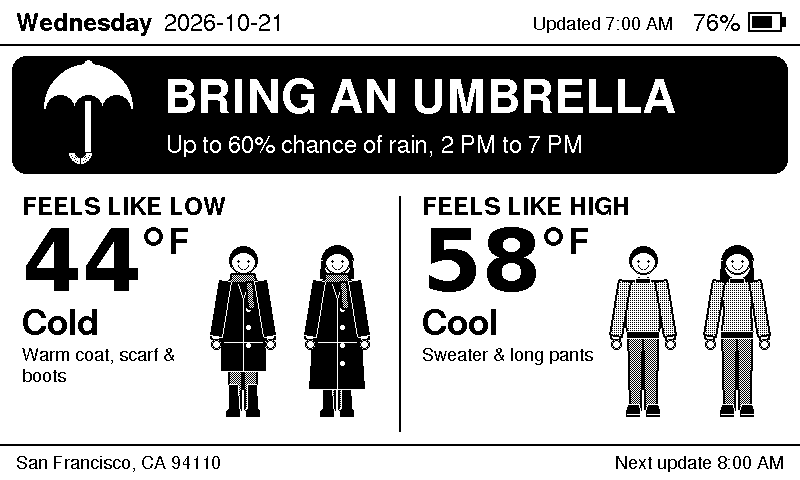 | 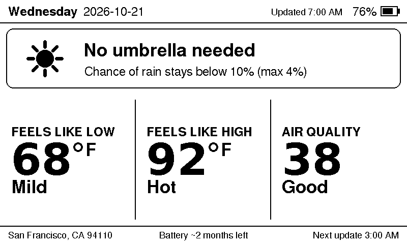 | 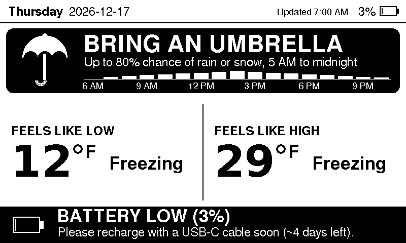 | 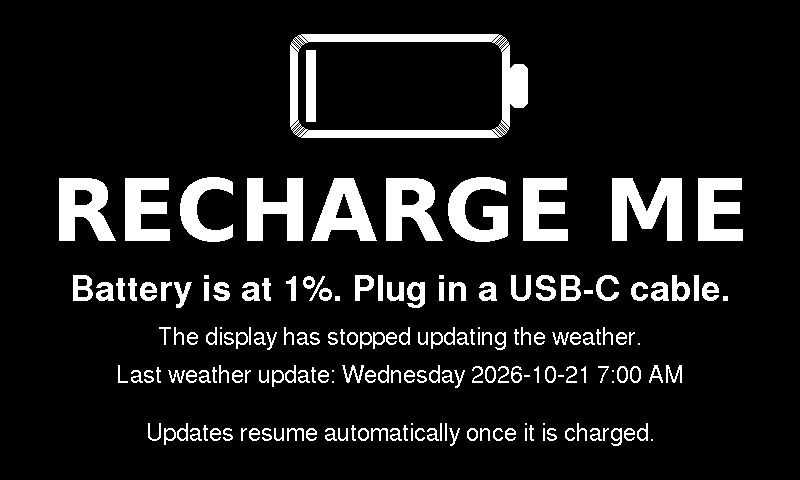 |

| Wi-Fi setup | Offline (stale data) | Set up in the evening (shows tomorrow) | Outfit tiers |
|---|---|---|---|
| 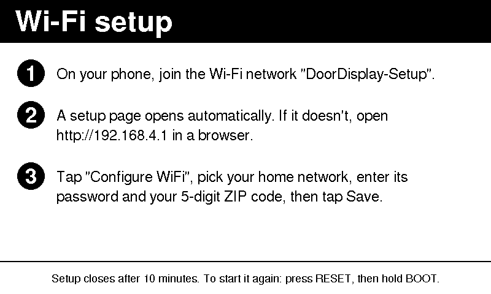 | 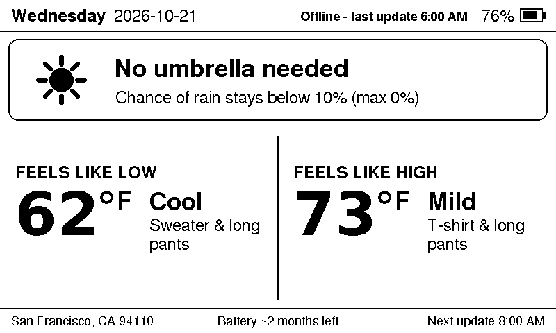 | 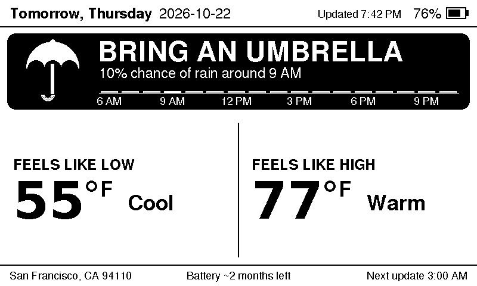 | 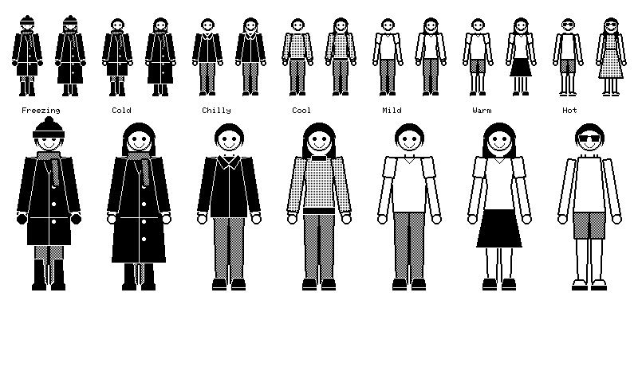 |

| Reminders | Reminders + rain + low battery | Reminders page (PIN) |
|---|---|---|
| 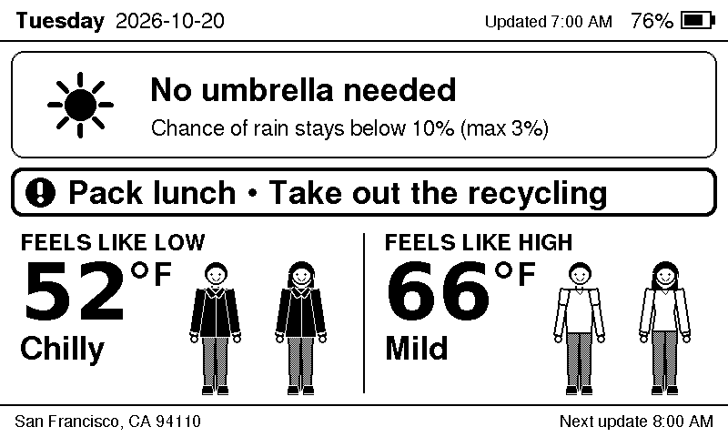 | 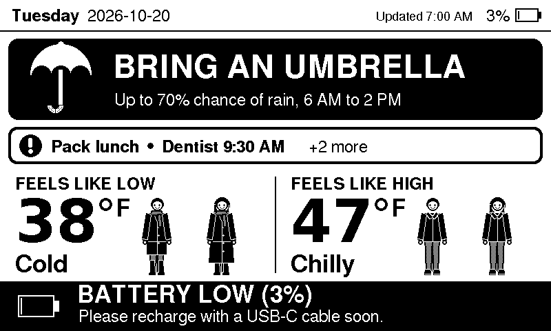 | 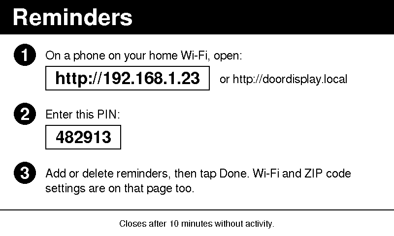 |

These images are rendered by the same drawing code the firmware uses (`make -C host preview`).

## Parts

| Part | Notes | ~Price |
|---|---|---|
| [DFRobot FireBeetle 2 ESP32-E](https://www.dfrobot.com/product-2195.html) (DFR0654) | ESP32 with USB-C, on-board LiPo charger, JST-PH battery jack, ~10 µA deep sleep, battery-voltage divider on GPIO34 | $9 |
| 7.5" 800×480 black/white e-paper panel: Waveshare 7.5" e-Paper **V2** (raw panel) or Good Display **GDEY075T7** | 24-pin FPC panel | $40–55 |
| E-paper SPI adapter: Good Display **DESPI-C02** or Waveshare **e-Paper Driver HAT** | Converts the FPC to 8 SPI wires. Often sold bundled with the panel ("7.5inch e-Paper HAT (V2)") | $5–10 |
| 3.7 V single-cell LiPo, 2000–3000 mAh, with protection circuit and **JST-PH 2.0** plug | e.g. 103450 / 104050 / 605080 cells | $8–12 |
| 8× female-female jumper wires (or solder) | | $2 |
| Frame/enclosure | 3D-printed case, or a shallow 5×7"/13×18 cm picture frame with a cut-out mat | $5–15 |
| Mounting | Removable adhesive strips (e.g. Command), or over-door hook | $5 |

**Check the LiPo plug polarity against the `+`/`−` marks on the FireBeetle before plugging it in.**
JST-PH batteries are not wired consistently between vendors, and reversed polarity will destroy the board.

### Wiring

| Display adapter pin | FireBeetle 2 ESP32-E GPIO |
|---|---|
| VCC / 3.3V | 3V3 |
| GND | GND |
| DIN / SDI / MOSI | 23 |
| CLK / SCK | 18 |
| CS | 13 |
| DC | 22 |
| RST / RES | 21 |
| BUSY | 14 |
| PWR (Waveshare HAT rev 2.3 only) | 3V3, or a GPIO set in `kPinEpdPower` |

All pins are in [`src/config.h`](src/config.h). The FireBeetle's USB-C port charges the battery
(the charge LED turns off when full) and is also used for flashing.

### Battery life

Rough budget with a 2000 mAh cell: each refresh is ~5 s of Wi-Fi (~100 mA) plus a ~4 s e-ink update,
≈ 0.25 mAh; 8 per day ≈ 2 mAh/day, plus ≈ 0.5 mAh/day of deep sleep. That's on the order of a year,
so the 2-month goal has plenty of headroom; in practice LiPo self-discharge and the board's
power LED matter more. To get the lowest sleep current, cut the FireBeetle's low-power jumper
(see DFRobot's wiki) and prefer the DESPI-C02 adapter, which draws almost nothing when the panel is
hibernated. With a Waveshare HAT rev 2.3, wire its PWR pin to a GPIO and set `kPinEpdPower` so the
firmware switches it off between refreshes.

## Software

- [VS Code](https://code.visualstudio.com/) with the [PlatformIO IDE](https://platformio.org/install/ide?install=vscode)
  extension, or PlatformIO Core (`pip install platformio`). PlatformIO downloads the ESP32 toolchain and the
  pinned libraries (GxEPD2, Adafruit GFX, ArduinoJson, WiFiManager) on the first build.
- A USB-serial driver only if the board's port doesn't show up (the FireBeetle 2 uses a CH340 chip).
- No accounts or API keys: forecasts come from [Open-Meteo](https://open-meteo.com/) and the ZIP lookup from
  [Zippopotam.us](https://zippopotam.us/).

### Build and flash

```sh
pio run -t upload        # build and flash over USB-C
pio device monitor       # optional serial log (115200)
```

If the screen stays blank or garbled, your panel is probably the newer GDEY075T7 controller: change
`DOOR_EPD_DRIVER` in `src/config.h` to `GxEPD2_750_GDEY075T7` and flash again.

Other settings in `src/config.h`: refresh window (`kRefreshStartHour`/`kRefreshEndHour`), °F/°C
(`kTemperatureUnit`), and `kBatteryMillivoltOffset` for calibrating the battery reading against a multimeter.

### Connecting to Wi-Fi

1. On first boot the display shows setup instructions and opens a Wi-Fi hotspot called **DoorDisplay-Setup**,
   protected by a random password shown on the screen.
2. Join it from your phone with that password; the setup page opens automatically (or browse to `http://192.168.4.1`).
3. Tap **Configure WiFi**, choose your network, enter its password and your **5-digit ZIP code**, and Save.

The device checks the ZIP code, stores the Wi-Fi credentials and location in flash, and draws the forecast.
To change Wi-Fi or ZIP later, press **RESET**, hold **BOOT** for 3 seconds, and tap **Change Wi-Fi or ZIP
code** on the reminders page (below); if the saved network can't be reached, it goes straight to the hotspot.
The hotspot closes after 10 minutes. If Wi-Fi is down at a scheduled refresh, it keeps showing the last forecast marked
"Offline - last update …" and tries again next hour.

### Reminders

Press **RESET**, then hold **BOOT** for 3 seconds. The display shows a local address (e.g. `http://192.168.1.23`
or `http://doordisplay.local`) and a one-time 6-digit PIN. Open it on a phone on your home Wi-Fi, enter the PIN,
and add reminders that repeat on chosen weekdays (e.g. *Pack lunch* on Tue and Thu) or happen on one future date.
Tap **Done** to redraw the display; the page also closes after 10 idle minutes.

- Up to 8 reminders, 40 characters each. One-off reminders are deleted automatically once their date passes.
- Reminders for the day shown appear in a bold strip under the rain banner; after 6 PM, tomorrow's.
  If they don't all fit on one line, the strip ends with "+N more".
- A new PIN is generated each time; 5 wrong PINs close the page until the next RESET + BOOT.

### Security notes

- The setup hotspot uses WPA2 with a new random 10-character password every time setup starts, so your home
  Wi-Fi password is encrypted over the air while you type it into the portal. Only someone who can see the
  screen can join. The portal's firmware-upload page is disabled, and the saved password is never shown.
- The Wi-Fi password is stored unencrypted in the ESP32's flash, so someone with physical access and a USB
  cable could read it. Mount it indoors, or put it on a guest/IoT network.
- The reminders page is plain HTTP on your home network and only runs while you have it open. It never
  shows or accepts the Wi-Fi password; access needs the PIN on the screen.
- Outside setup and the reminders page, the device makes only outbound requests (Open-Meteo, Zippopotam.us, NTP) and turns Wi-Fi off between refreshes.
  HTTPS certificates are not verified: a man-in-the-middle could show fake weather, but no credentials or
  personal data are sent.

## How it behaves

- **Schedule:** refreshes at 3:00, 4:00, …, 10:00 local time, then sleeps until 3:00 the next morning. Local time
  and DST come from the time zone Open-Meteo reports for your ZIP code; the clock is re-synced with NTP every
  wake, and the firmware learns the ESP32 sleep-timer drift so wakes stay on the hour.
- **Rain:** "likely" means any hour from now until midnight has ≥ 10% precipitation probability (snow counts).
  The subtitle shows the peak chance and the time span.
- **Feels like:** Open-Meteo's daily apparent-temperature min/max. Outfits use 7 tiers: Freezing < 32°F,
  Cold < 45, Chilly < 55, Cool < 65, Mild < 75, Warm < 85, Hot.
- **After 6 PM** (e.g. when you first set it up in the evening) it shows tomorrow's forecast.
- **Battery:** 5% and above is normal; 2–4% adds the bottom banner; 0–1% shows the full-screen warning
  and stops using Wi-Fi, re-checking every 30 minutes so it recovers on its own after a charge.

## Development

```
src/            ESP32 firmware (Wi-Fi, HTTP, NTP, deep sleep, display driver)
lib/doorcore/   portable logic and drawing: schedule, battery curve, forecast parsing, outfits, screens
host/           desktop unit tests and PNG preview renderer for lib/doorcore
```

```sh
make -C host test      # unit tests (needs g++ and git)
make -C host preview   # regenerate docs/img/*.png
make -C host server    # try the reminders page at http://localhost:8080 (PIN is printed)
pio run                # firmware build
```
